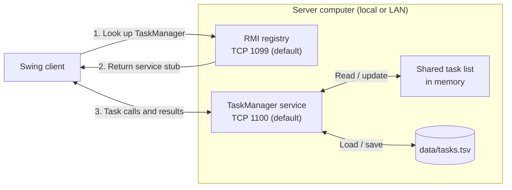

# Task Manager

A small task manager with a Java Swing desktop client and a Java Remote Method Invocation (RMI) server. Add, edit, complete, and remove tasks, set optional due dates, and keep changes across server restarts. Multiple clients share the same list and refresh automatically. The project uses only the Java standard library.

## Demo

https://github.com/user-attachments/assets/7a3920f6-4f91-400e-a4b2-dd21834c3735

## Requirements

- A **JDK 11 or newer**, with both `java` and `javac` on `PATH`.
- A graphical desktop for the Swing client. The server can run without a display.
- PowerShell on Windows, or a POSIX shell on Linux/macOS, for the optional build scripts.

Check your installation with `java -version` and `javac -version`. Run the commands below from the repository root. Use the same compiled application version on the client and server.

After updating the sources, stop older server/client processes, rebuild, and restart them together.

## Run locally

### Windows / PowerShell

Build once:

```powershell
.\build.ps1
```

Start the server in one terminal:

```powershell
java -cp out TaskServer
```

Keep that terminal open. Start the client in a second terminal:

```powershell
java -cp out TaskClient
```

If PowerShell policy prevents running the build script, compile directly, then use the same server and client commands:

```powershell
New-Item -ItemType Directory -Force out | Out-Null
javac --release 11 -Xlint:all -Werror -d out src/*.java
```

### Linux / macOS

Build and start the server:

```sh
sh ./build.sh
java -cp out TaskServer
```

Start the client from the repository root in a second terminal:

```sh
java -cp out TaskClient
```

Alternatively, compile directly:

```sh
mkdir -p out
javac --release 11 -Xlint:all -Werror -d out ./src/*.java
```

The server creates its own RMI registry and exports its service. You do **not** need to run `rmiregistry` separately or generate stubs with `rmic`; Java creates the remote stubs dynamically. See the [Java RMI server specification](https://docs.oracle.com/en/java/javase/11/docs/specs/rmi/server.html).

## Use the application

1. Start the server, then open one or more clients.
2. Type a description in the **Task** field. Optionally enter a due date as **YYYY-MM-DD**, or leave it blank for no deadline.
3. Press **Enter** or choose **Add Task** to save the new task.
4. Check **Done** to complete a task; uncheck it to reopen it. Completed descriptions appear crossed out.
5. Select a task and choose **Edit Task** to change its description or due date. Clear the date field to remove a deadline.
6. Choose **Remove Task** to remove the selected task, or **Delete All** and confirm to clear the list.
7. Choose **Refresh** to fetch changes immediately or reconnect after a connection failure.

Each successful change fetches the complete list again. While connected, clients attempt an automatic refresh every **5 seconds**, skipping a refresh while another request, dialog, or checkbox edit is active. Network and UI delays can make updates take longer than five seconds. A failed background refresh marks the connection as disconnected without opening an error dialog; use **Refresh** to reconnect.

Task descriptions have leading and trailing whitespace removed. Null or blank descriptions, invalid Unicode text, and normalized descriptions longer than 1,000 UTF-16 code units are rejected by the server. An absent due date is valid. The list holds at most 10,000 tasks. Each task has a stable ID, so duplicate descriptions can be edited, completed, and removed independently. Click a table heading to sort the list.

An unfinished task becomes **Overdue** when its due date is before today's date on the client computer. Tasks due today stay open, and completed tasks are never marked overdue. Passing a deadline does not delete a task.

Tasks are saved on the server in **`data/tasks.tsv`**, including IDs, completion status, and due dates. Closing clients or restarting the server preserves the list. Stop the server with `Ctrl+C` in its terminal. Start it from the same directory, or use an explicit data-file path, to reopen the same list.

The data file uses a versioned, tab-separated UTF-8 format. Descriptions are Base64-encoded to preserve tabs, line breaks, and Unicode. Saves replace the previous file through a temporary file, and failed saves leave the in-memory list unchanged. A file lock prevents two servers from writing the same file. Unreadable or invalid storage causes startup to fail instead of silently replacing the saved list. Generated data and lock files under `data/` are excluded from Git.

If an operation reports a connection error, use **Refresh** and inspect the list before trying again. A failed remote call can have reached the server even if its response did not reach the client. Mutations are not automatically retried.

## Configuration and trusted LAN use

```text
TaskServer [bind-address [registry-port [service-port [data-file]]]]
TaskClient [host [registry-port]]
```

| Setting | Default |
| --- | --- |
| Server bind address / client host | `127.0.0.1` |
| Registry TCP port | `1099` |
| Task service TCP port | `1100` |
| Registry binding name | `TaskManager` |
| Server data file | `data/tasks.tsv` relative to the server's working directory |

For command-line help:

```sh
java -cp out TaskServer --help
java -cp out TaskClient --help
```

The default server accepts connections on the local loopback interface. To share a list on a trusted LAN, supply the server computer's actual LAN address. For example, if that computer has address `192.168.1.20`:

```sh
# On the server computer:
java -cp out TaskServer 192.168.1.20

# On each client computer, after compiling the same sources:
java -cp out TaskClient 192.168.1.20
```

Custom ports work similarly:

```sh
java -cp out TaskServer 192.168.1.20 2099 2100
java -cp out TaskClient 192.168.1.20 2099
```

To choose a different file for a personal list:

```sh
java -cp out TaskServer 127.0.0.1 1099 1100 data/personal-tasks.tsv
```

Both server ports must be reachable from clients. The client first contacts the registry, then obtains the service's address and port from its remote stub. The server binds both listeners to the specified resolved interface and advertises that address. It rejects wildcard addresses such as `0.0.0.0` and `::`; choose an address assigned to the server computer. Server ports must be distinct integers from `1` to `65535`; the client's registry port has the same range.

The application has **no authentication or TLS**. Every connected client can read and modify the entire list. Keep it on the local machine or a trusted private network; do not expose its ports to the public internet.

Custom RMI socket factories control interface binding and apply a 3-second connection timeout and a 5-second socket read timeout. DNS resolution and multi-step operations can take longer than an individual timeout. See Oracle's [custom RMI socket factory guide](https://docs.oracle.com/javase/8/docs/technotes/guides/rmi/socketfactory/index.html).

## How it works



The registry returns a stub to the client. Subsequent task calls go directly to the service, which manages the shared list and its saved file.

Java source files are in `src/`, regression tests are in `tests/`, and the build scripts and documentation are in the repository root.

| File / directory | Purpose |
| --- | --- |
| `src/Task.java` | Immutable task data: ID, description, completion, and optional due date. |
| `src/TaskManager.java` | Remote contract for adding, editing, completing, removing, reading, and clearing tasks. |
| `src/TaskManagerImpl.java` | Validates requests, saves changes, and protects shared state; reads return independent snapshots. |
| `src/TaskStore.java` | Loads and saves the local data file and owns its file lock. |
| `src/TaskServer.java` | Parses configuration, starts the registry and service, and handles startup/shutdown. |
| `src/TaskTransport.java` | Shared connection settings, argument validation, and RMI socket factories. |
| `src/TaskClient.java` | Swing interface; performs remote work in the background and updates the UI on Swing's event thread. |
| `src/TaskClientStyle.java` | Shared colors, typography, and control styling for the client and dialogs. |
| `src/TaskClientConnection.java` | Client connection and remote-operation logic, separate from the Swing interface. |
| `src/TaskTableModel.java` | Checkbox and task table data, with operations targeted by task ID. |
| `build.ps1`, `build.sh` | Compile with Java 11 compatibility and strict compiler warnings; optionally run tests. |
| `tests/` | Dependency-free regression and integration checks. |
| `out/` | Generated class files; excluded from version control. |
| `data/` | Server task storage; excluded from version control. |

RMI calls can arrive concurrently. The service synchronizes task operations and returns a copy of the list so callers cannot mutate its internal state. Individual remote methods are atomic; a mutation followed by a separate refresh can also show concurrent changes from another client.

## Build and verify

Run the dependency-free test suite:

```powershell
# Windows / PowerShell
.\build.ps1 -Test
```

```sh
# Linux / macOS
sh ./build.sh --test
```

Both scripts compile with `--release 11 -Xlint:all -Werror`. Test mode also compiles `tests/*.java` and runs `TaskManagerImplTest`, `TaskStoreTest`, `TaskIntegrationTest`, `TaskClientTest`, `TaskTableModelTest`, and `TaskTransportTest`. These checks cover task identity and dates, storage/restart recovery, failed saves, concurrent access, RMI communication, background client operations, table behavior, text preservation when editing, and stalled connection timeouts. Tests run headlessly; use the manual check below to exercise the desktop interface. Storage tests use temporary files. Integration checks use local sockets; run them in an environment that permits loopback networking. A successful run exits with status `0`; a failed compile or check exits with a nonzero status.

For a manual check, open two clients against one server. Add a task with yesterday's due date and check its **Overdue** status. Complete it, edit it, and wait for the second client's next automatic refresh. Try duplicate descriptions and sort the table before editing one. Stop and restart the server, choose **Refresh** in an existing client, and confirm that descriptions, completion, and due dates were restored.

## Troubleshooting

| Symptom | What to check |
| --- | --- |
| `java` or `javac` is not recognized | Install a JDK and add its `bin` directory to `PATH`. A runtime-only installation does not include `javac`. |
| Compilation rejects `--release 11` | Check `javac -version`; use JDK 11 or newer. |
| Could not find or load main class | Compile from the repository root, then use `java -cp out TaskServer` or `java -cp out TaskClient` from that directory. |
| Address already in use / port in use | Stop an existing server or choose two unused ports. Do not start a separate `rmiregistry`. Pass the chosen registry port to the client. |
| Cannot assign requested address | The bind address must belong to the server computer. Use `127.0.0.1` locally or its actual LAN address. |
| Connection refused / connection failure | Start the server first; check its terminal output and the client's host/registry port. After a restart, choose **Refresh**. |
| Registry lookup works but task operations time out | Check reachability and firewall rules for **both** the registry and service ports. Verify that the server advertises an address reachable from the client. |
| Another client's changes are missing | Wait for an automatic refresh while connected or choose **Refresh**. Requests, dialogs, checkbox editing, and network delays can postpone updates. |
| Headless environment / no display | Run the server there and start the Swing client on a machine with a graphical desktop. |
| A different list appears after restarting | Check the data-file path printed by the server. Relative paths depend on the directory from which the server starts. |
| The data file is locked | Stop the other server using that file, or choose a different data file and unused ports. |
| Storage cannot be read or saved | Check the server's error and file permissions. Preserve the file before repairing invalid content; the server will not silently reset it. |

## License

Copyright (c) 2026 Adam Zouari.

Task Manager's source code and project documentation are available under the [PolyForm Strict License 1.0.0](LICENSE). This is a source-available license: it permits the uses defined in its terms but does not grant permission to modify or redistribute the software. Uses outside those permissions require a separate license from the copyright holder.
